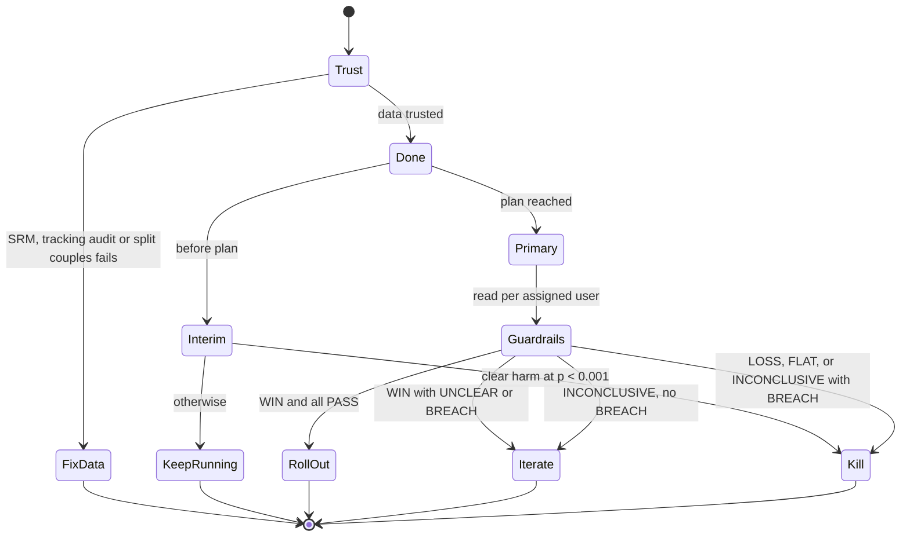

# PRD: Ship or Kill, an A/B test readout that makes the call and shows its working

Akshay Dhar · 22 October 2026 · Status: v1, written before any code or test data existed

## TL;DR

A product team runs an A/B test on onboarding, an invite flow or a push notification. Two weeks later
someone has to say **roll out, iterate or kill**. The numbers rarely agree with each other: D1 retention
is up 6%, D0 activation is down 4% at p = 0.08, one platform looks odd, and the test was planned for
another week. Most teams decide by reading the primary metric's p-value and arguing about the rest.

**Ship or Kill** reads a test the way a careful analyst would, in a fixed order, and writes the call
with its reasons:

1. **Can the data be trusted?** Sample ratio mismatch, overall and by segment, and tracking audits for
   events no real user can produce.
2. **Is the test done?** It won't call a winner before the planned sample and duration (no peeking).
   It can stop early only for clear harm.
3. **Did the primary metric move, per assigned user?** A metric whose denominator was chosen after
   assignment (retention "of activated users") is replaced by its per-assigned version, because a
   variant that filters out weaker users makes a conditional rate rise on its own.
4. **Can we rule out harm?** Each guardrail is tested for non-inferiority against a margin agreed before
   the test. "Not significantly worse" is not the same as "not worse".
5. **The call:** roll out, iterate (with the reason and the next step), kill, or fix the data first.

It is a free web page that takes counts, not a platform: paste the per-arm numbers from PostHog,
Mixpanel, a SQL query or a spreadsheet. A test planner sizes the test before launch.

**It is tested before it is trusted.** It is scored on a frozen benchmark of couples-app experiments
simulated from raw event logs, each with a known true effect, including the traps above. It is also run
on two public experiments. The comparison is the rule most teams use: ship if the primary metric is up
with p < 0.05.

## Problem and evidence

**Most tests don't win, so a false "win" is common.** At Microsoft, about a third of ideas tested
improved the metric they were designed to improve (Kohavi et al., KDD 2012). Secondary sources put the
rate at 10-15% at other large companies; I treat that figure as unverified. When most variants are
neutral, every decision rule that is loose about noise ships many of them.

**Broken data looks like a result.** Microsoft found that about 6% of its experiments had a sample ratio
mismatch (Fabijan et al., KDD 2019): the split between arms was not what was planned, usually because a
bug removed users from one arm. A variant that crashes for some users before they are counted loses its
weakest users from the data and looks better than it is.

**Peeking turns noise into wins.** In 1,000 A/A tests at Wish, analysing at the planned sample size gave
about 4.7% false positives; stopping at the first p < 0.05 gave about 21% (Wish engineering, as
published on Towards Data Science).

**Conditional metrics reward filtering.** If a variant adds friction to onboarding, fewer users activate,
and the ones who do are the more committed ones. Their D1 retention rises even if the variant retains
fewer users in total. Udacity's "free trial screener" experiment, a teaching dataset from its A/B testing
course, has this shape: fewer enrolments, a higher share of enrolled students paying, and no clear change
in payments per click.

**Platforms now recommend a decision, with significance-based guardrails.** GrowthBook launched an
Experiment Decision Framework in May 2025 with statuses like "Ship now" and "Roll back now". Its example
rule is to ship "unless any guardrail metrics are statistically significant and negative". Statsig's
Decision Framework "highlights recommended actions but doesn't enforce them". A significance rule passes
any harm the test is too small to detect. Neither publishes how often its recommendation is right.

**Couples apps have a trap of their own.** The product is used by two people. If each partner is
randomised separately, half the couples are split across arms: an effect that needs both partners (a
shared game, a joint streak) is diluted, and the control experience is contaminated.

## Users and jobs to be done

- **PM at an early-stage consumer app** (PostHog or Mixpanel, no experimentation platform). *"The test
  ended. Tell me whether to roll it out, with reasons I can defend to the founder, and tell me if the
  data itself is broken."*
- **Founder reviewing a readout.** *"The PM says it won. Show me what was checked before that call."*
- **PM planning a test.** *"How many couples and how many days do I need to detect a 1.5-point lift in
  D1 retention, and can I also rule out a rise in uninstalls?"*

## Competitive landscape and positioning

| Tool | What it does | Gap for this job |
| --- | --- | --- |
| GrowthBook Experiment Decision Framework (2025) | Ship or roll-back statuses from rules on goal and guardrail metrics, gated on a target MDE | Needs GrowthBook; documented guardrail rule is significance-based; no published accuracy |
| Statsig Decision Framework | Recommended action from primary and guardrail metrics; advisory | Needs Statsig; weighting not documented; no published accuracy |
| PostHog / Mixpanel experiments | Per-metric results and significance | The call, the trust checks and the guardrail logic are left to the reader |
| Spreadsheet and a p-value calculator | What many small teams use | No trust checks; peeking and conditional metrics go unnoticed |

**Positioning:**

- **Counts in, call out.** Works with any analytics stack. Paste per-arm counts.
- **Trust before results.** SRM and tracking audits come first and can block the call.
- **Non-inferiority guardrails.** A guardrail passes only when the test rules out a harm bigger than the
  agreed margin.
- **Shows its working.** Every step, number and threshold is on the page.
- **Tested in public.** Its benchmark score, failures included, is published next to the tool.

## Goals and non-goals

Goals:

1. Never recommend rolling out a variant that isn't a real win; the target is at most 5% of non-winning
   variants in the benchmark.
2. Catch broken experiments (sample ratio mismatch, tracking bugs, split couples) before reading results.
3. Not kill real winners: at most 5% of true winners get "kill".
4. Explain each call in plain language, with the next step.
5. Size a test before launch, including whether its guardrails can be tested.

Non-goals (v1):

- **More than two arms.** A/B only.
- **Sequential or Bayesian testing.** v1 is a fixed-horizon test with an interim harm check. Always-valid
  inference is a later step.
- **Variance reduction (CUPED).** Later.
- **Connecting to analytics tools.** v1 takes counts, plus a SQL template that produces them from
  PostHog-style events.
- **Heterogeneous effects.** Segment results are shown for trust checks only, never as a reason to ship
  to one segment.

## MVP scope

1. **Readout page.** A form for per-arm counts (assigned users, then each metric's numerator and
   denominator), the planned sample and duration, guardrail margins, segment counts and tracking audits.
   It also accepts the same thing as JSON. Presets load the public experiments and benchmark cases.
2. **Planner.** Sample size per arm for the primary metric (two-sided α, power), days needed at a given
   daily volume (rounded up to whole weeks), and the change each guardrail must stay under for its margin
   to be confirmed at that size.
3. **Engine.** One JavaScript module, used by the page and by the benchmark runner, so the published
   score is the score of the code people use.
4. **SQL template.** Turns a PostHog-style event table into the readout counts, with D1 and D7 windows
   counted only for users whose window has closed.
5. **Benchmark explorer.** Every benchmark case, with the true effect, the engine's call and the naive
   call.

## The decision rule (v1)

**1. Trust.**
- **Sample ratio mismatch:** chi-square goodness of fit of assigned users against the planned split,
  overall and for each segment provided (for example Android old, Android new, iOS). Fail at p < 0.001;
  warn at p < 0.01.
- **Tracking audits:** counts of events no real user produces, per arm. Each audit has a threshold:
  - a shared game with no partner joined: 0.5% of assigned;
  - a user seen in both arms: 0.5% of assigned;
  - a partner in the other arm: 1% of joined couples.
  An audit fails if either arm exceeds its threshold, or if the arms differ at p < 0.001 and one arm's
  rate is more than double the other's.

**2. Done.** A readout is final when the planned days have passed (whole weeks) and each arm has at
least 90% of the planned sample. Before that it is an interim look: the only call allowed is kill for
clear harm (the primary is worse, or a guardrail is harmed beyond its margin, at p < 0.001). Otherwise
"keep running".

**3. Primary.** The difference in rates, test minus control, with a 95% confidence interval
(Agresti-Caffo adjusted Wald). With the minimum worthwhile effect (MWE) agreed before the test:
- **WIN:** the whole interval is above zero;
- **LOSS:** the whole interval is below zero;
- **FLAT:** the interval contains zero and its upper end is below the MWE (the test rules out a
  worthwhile effect);
- **INCONCLUSIVE:** the interval contains zero and reaches the MWE (the test can't tell).

The primary must be measured per assigned user. If its denominator is a subset chosen after assignment
(activated users, users who reached a screen), the engine uses the per-assigned version supplied with it,
and with none supplied it won't roll out.

**4. Guardrails.** Non-inferiority at one-sided 5%, using a 90% interval for the harm (the change in the
bad direction) against the margin agreed before the test:
- **PASS:** the worst plausible harm (top of the interval) is within the margin;
- **BREACH:** the harm is significant (bottom of the interval above zero) and the estimate is beyond the
  margin;
- **UNCLEAR:** anything else. The test can't rule out a harm bigger than the margin.

**5. The call.**

| Primary | Guardrails | Call | Next step written by the engine |
| --- | --- | --- | --- |
| WIN | all PASS | **Roll out** | Ramp to 100%; keep a 5% holdback if the change is large |
| WIN | any BREACH | **Iterate** | It works but costs a guardrail: change the design, then retest |
| WIN | any UNCLEAR | **Iterate** | Extend the test until the guardrail is ruled out |
| LOSS | any | **Kill** | Keep control |
| FLAT | any | **Kill** | Keep control (the simpler product); the idea doesn't move the metric enough |
| INCONCLUSIVE | any BREACH | **Kill** | It harms a guardrail with no proven gain |
| INCONCLUSIVE | none breached | **Iterate** | Rerun with the sample the planner gives for the MWE, or rethink |

Secondary metrics (D7 retention, retention of activated users) are shown to explain the mechanism and
never decide.

## Variant logic for a couples app

- **Unit of randomisation: the couple, keyed by the first partner to install.** The invitee inherits the
  inviter's variant through the invite token. Both exposures carry the couple id.
- **Analysis unit: the installer, counted from exposure (intention to treat).** An installer whose
  partner never joins stays in the denominator.
- **Exposure is logged where the change is seen**, not at app open, so users who never reach the surface
  don't dilute the effect. For onboarding tests, every installer reaches it.

Edge cases:

| Case | Rule |
| --- | --- |
| Both partners install on their own, then pair across arms | Analysed in their original arms; counted in the split-couple audit; after pairing, the app shows the variant of whoever was exposed first |
| Invite opened on desktop or the web | The web page doesn't evaluate the flag; the token carries the variant to the app install |
| Reinstall or new device | The login id keeps the first assignment; an anonymous id that changes shows up in the both-arms audit |
| Couple unpairs during the test | Stays in its assigned arm |
| Invitee already in another experiment on the same surface | Mutually exclusive experiment layers, or the couple is excluded from the newer test and logged |

## How it is tested

**The benchmark (built and frozen before the engine is written).** Couples-app experiments simulated at
the level of raw events (exposure, onboarding, invite, partner joined, shared game, app opens, push
disabled, crash, uninstall), with natural event loss. The readout counts are computed from the events by
the SQL template. Each case has a true effect, computed exactly from the simulation's parameters. Case
types:

- **Clean** win, null and loss.
- **Denominator trap:** an onboarding gate that filters out weaker users; the team's primary is D1
  retention of activated users.
- **Guardrail harm:** a bedtime push that lifts D1 but raises push disables and uninstalls beyond the
  margin.
- **SRM bug:** the variant crashes before exposure is logged on old Android devices.
- **Tracking bug:** the variant fires the shared-game event on a solo game.
- **Peeking:** a null variant read on the first day the team saw p < 0.05.
- **Held-out only:**
  - quiet guardrail harm, beyond the margin but not significant;
  - couples split across arms;
  - underpowered true winners.

The development set has 6 cases of each of the first eight types (48). The held-out set has 8 of each of
all eleven types (88). It is run once, with the engine frozen in git first.

**Truth labels**, from the true effects:
- **winner:** the per-assigned primary improves by at least the MWE and no guardrail is harmed beyond its
  margin;
- **harmful:** the primary worsens or a guardrail is harmed beyond its margin;
- **neutral:** anything else.

**Hypothesis, stated before any case exists:** on the held-out set, the naive rule (ship if the team's
primary metric is up with p < 0.05 at the time of the readout) ships at least 20% of the variants that
are not winners. Ship or Kill ships at most 5%, and misses at most 15 percentage points more of the true
winners than the naive rule does.

**Release gate (held-out):**
- **Wrong roll-outs** (roll out on a case that is not a winner): ≤ 5% of non-winners.
- **Data problems caught** (fix the data first, on cases with a planted problem): ≥ 90%.
- **False data alarms** on cases with no planted problem: ≤ 5%.
- **Winners killed:** ≤ 5% of true winners.

**Also reported:**
- missed winners, as the cost of caution;
- a second baseline, the naive rule plus "don't ship if any guardrail is significantly worse";
- results by case type.

**Public experiments** (not part of the gate, since their true effects are unknown):
- **Cookie Cats:** a mobile game, 90,189 players, gate at level 30 or 40, D1 and D7 retention;
- **Udacity free-trial screener:** daily counts of clicks, enrolments and payments.

## Risks

- **The benchmark tests the traps the engine was built for.** It shows that the checks work and what
  they cost. It doesn't show how common these traps are in real teams. The held-out set includes three
  case types the engine was not tuned on, and the public experiments are reported separately.
- **Strict guardrails cost winners.** Non-inferiority needs sample. The planner shows that cost before
  launch, and the benchmark reports missed winners.
- **Simulated users are not real users.** The base rates are illustrative, not any company's numbers.

## Roadmap

1. Sequential testing (always-valid intervals) so teams can look daily without inflating false positives.
2. CUPED variance reduction from pre-period activity.
3. Read counts directly from PostHog through its query API.
4. Multi-arm tests and ratio metrics (sessions per user) with the delta method.
