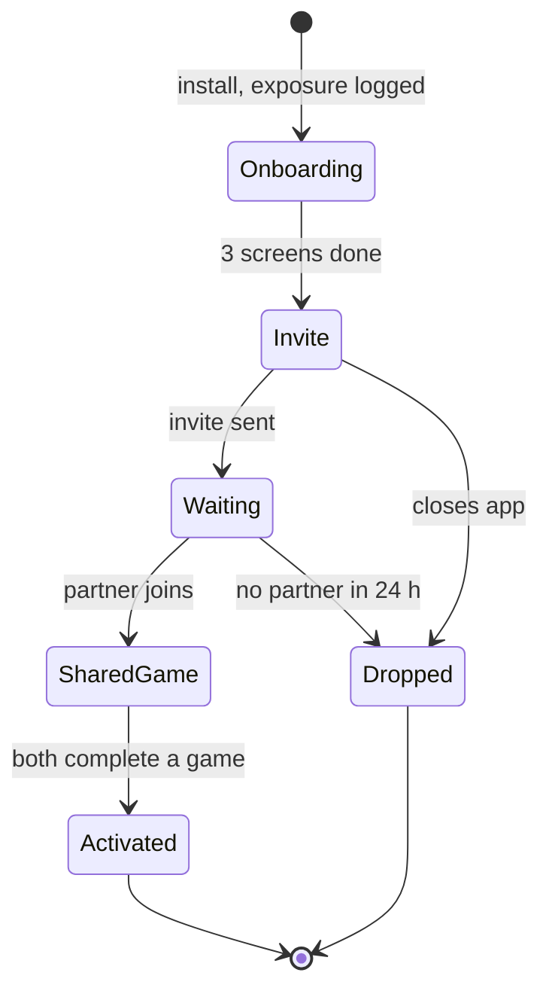
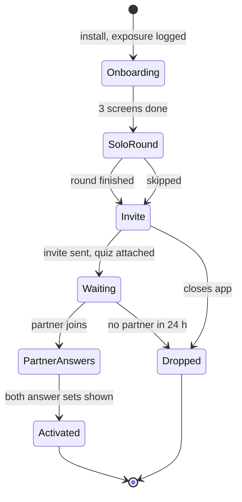

# Test plan: "Play first, pair later"

An example of the plan Ship or Kill expects before a test starts, written for a couples app. It is a sample
of the format, not a real company's plan: the base rates are the simulation's illustrative ones.

Akshay Dhar · 22 October 2026 · Status: example

## The change

**Today (control):** install → three onboarding screens → "Invite your partner" → a waiting screen until
the partner joins → the first shared game.

**Variant (test):** install → three onboarding screens → **one solo round of tonight's couple quiz (about
2 minutes)** → "Invite your partner to answer the same questions" → waiting screen → the partner plays →
both see each other's answers (the first shared game).

## Hypothesis

If new installers play one solo round before the invite, **D0 couple activation** (partner joined and first
shared game completed within 24 hours of install) will rise by at least **8% relative**. Two reasons:

- the invite then carries something personal ("see how your answers compare");
- the installer has already felt the product, so fewer abandon on the waiting screen.

**What would prove it wrong:**
- activation flat or down;
- or the solo round becomes a substitute: installers play alone and never invite, so invites sent fall.

## Variants and state diagrams

Control:

Test:

## Variant logic

- **Flag:** `exp_play_first_pair_later`, 50/50, evaluated when the first onboarding screen renders. That is
  also where the exposure event `$feature_flag_called` is sent: the first point where the arms differ.
- **Unit:** the couple, keyed by the installer. The invite link carries a signed token with the installer's
  variant. The partner's app reads the token at first open and uses that variant without evaluating the
  flag itself.
- **Analysis:** per installer, counted from exposure (intention to treat). An installer whose partner never
  joins stays in the denominator.
- **The solo round can be skipped.** Skippers stay in the test arm.
- **Layering:** mutually exclusive with any other onboarding or invite experiment.

| Edge case | Rule |
| --- | --- |
| Partner already has the app (installed on their own) and is in the other arm | Analysed in original arms; counted in the split-couple audit; once paired, the pair sees the inviter's variant |
| Invite opened on a laptop | The web page keeps the token and forwards it to the store link; the variant survives install |
| Invite token missing or tampered with | The partner gets the inviter's variant from the server-side pairing record; if that fails, the pair is excluded and logged |
| Reinstall, or a new device with the same login | The first assignment sticks to the account; an anonymous id that changes shows up in the both-arms audit |
| Both partners install on the same evening before pairing | Whoever was exposed first defines the couple's variant; the other partner's own exposure is logged but they're analysed as the invitee |
| App killed during the solo round | Resume at the solo round on next open, within 24 hours |
| Push permission prompt | Unchanged and at the same step in both arms, so it can't confound the test |

## Tracking plan

| Event | When | Key properties |
| --- | --- | --- |
| `$feature_flag_called` | First onboarding screen renders | `flag`, `variant`, `couple_id`, `platform`, `os_version_group` |
| `onboarding_completed` | Third screen done | |
| `solo_round_completed` / `solo_round_skipped` | Test arm only | `round_id`, `seconds` |
| `partner_invite_sent` | Invite shared | `channel` (WhatsApp, SMS, link), `has_quiz` |
| `partner_joined` | Partner's account linked | `partner_variant` (from the token), `couple_id` |
| `shared_game_completed` | **Both** partners completed the same game | `game_id`, `couple_id` |
| `app_opened`, `push_disabled`, `app_crashed`, `app_uninstalled` | As today | |

**QA before launch:**
- run both builds on a test couple;
- check that the solo round does **not** send `shared_game_completed`. In the Ship or Kill benchmark, a solo
  game firing the shared event is one of the planted bugs.

**Audits during the test** (the readout's trust checks):
- shared game with no partner joined (limit 0.5% of installers);
- users in both arms (limit 0.5%);
- partner joined from the other arm (limit 1% of joined couples);
- sample ratio overall and by `os_version_group`, since a heavier first screen can crash old Android
  devices before exposure is logged.

## Metrics

| Role | Metric | Definition (per installer, from exposure) | Threshold |
| --- | --- | --- | --- |
| Primary | D0 couple activation | `shared_game_completed` within 24 h | Minimum worthwhile effect +8% relative (25% → 27%) |
| Guardrail | D1 retention | `app_opened` between 24 and 48 h | Margin -6% relative |
| Guardrail | Uninstalls within 48 h | `app_uninstalled` within 48 h | Margin +15% relative |
| Guardrail | Users with a crash within 48 h | `app_crashed` within 48 h | Margin +30% relative |
| Secondary | Invites sent | `partner_invite_sent` within 24 h | Explains the mechanism |
| Secondary | Time to pair | median minutes from exposure to `partner_joined` | Explains the mechanism |
| Secondary | D7 retention | `app_opened` on day 7 | Read on mature cohorts only |

The SQL for these windows, including "count a user only once their window has closed", is
[`sql/readout.sql`](../sql/readout.sql).

## Sample size and duration

From the Ship or Kill planner, at about 1,500 installs a day, 50/50:

| Sizing | Per arm | Duration |
| --- | --- | --- |
| Primary only (what a standard calculator gives) | 7,550 | 14 days |
| Every check, with D1 margin -4%, uninstalls +12%, crashes +25% | 31,565 | 49 days |
| **Every check, with the margins above (D1 -6%, uninstalls +15%, crashes +30%)** | **14,029** | **21 days** |

The D1 retention guardrail sets the size: ruling out a small D1 drop needs more users than detecting the
activation lift. A -4% D1 margin would need seven weeks. **Decision: accept a -6% D1 margin and run three
full weeks.** Day-of-week effects cancel out over whole weeks, and evening usage peaks are covered every
day.

## Readout rules, agreed now

- **No early win.** Interim looks may only stop the test for clear harm (p < 0.001): primary down, or a
  guardrail beyond its margin.
- **Final readout:** day 23, two days after enrolment ends, so every D1 window has closed. Read with Ship
  or Kill:
  - trust checks first;
  - primary per installer, 95% interval;
  - guardrails non-inferior at one-sided 5%.
- **What each call means here:**
  - **Roll out:** ramp to 100%, keep a 5% holdback for 4 weeks to check D7 and D30.
  - **Iterate:**
    - if invites sent fell (the solo round became a substitute), shorten it or make the invite part of it;
    - if a guardrail can't be ruled out, extend by one week.
  - **Kill:** keep the current flow, and log what the result says about "show value before the ask".

## Risks

- **Novelty:** new installers have never seen control, so novelty is limited, but the holdback checks that
  the effect lasts.
- **Partner experience:** the invitee's own D1 matters too. Read it as a secondary from the invitee side
  (same couple ids) before ramping.
- **Seasonality:** avoid launching across a festival week, when installs and intent shift.
